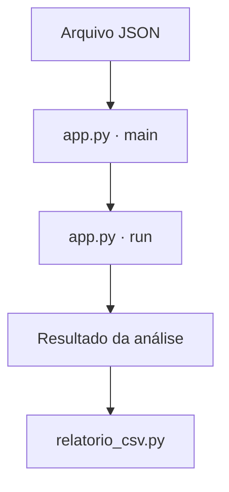

# Engenharia reversa e estudo — Rotas alternativas na Grande Natal

## Objetivo e fluxo

Planejamento de trajetos por links com paradas e alternativas. Em app.py, rota e _url geram endereços navegáveis e run aplica as regras de comparação. O navegador abre os links produzidos.

**Tecnologias identificadas** · Python.

**Revisão de referência** · `5e118eb2130a`.

## Mapa do código

| Caminho | Papel de leitura | Símbolos selecionados |
| --- | --- | --- |
| [app.py](../app.py) | Ponto de leitura para entrada ou composição | `texto`, `textos`, `_url`, `rota`, `run`, `objeto_sem_campos_repetidos`, `rejeitar_constante_json`, `main` |
| [relatorio_csv.py](../relatorio_csv.py) | Implementação | `celula`, `linhas`, `escrever_csv` |

## Roteiro de estudo e desenvolvimento

1. Comece pelo fluxo descrito acima e localize seus pontos de entrada no mapa. Acompanhe uma entrada válida até a transformação ou a resposta.
2. Abra um teste relacionado ao fluxo e descreva qual regra ele protege. Compare o tratamento esperado para entradas válidas, inválidas e nos limites.
3. Ao adicionar uma regra, determine qual módulo controla o dado e cubra o caso nesse nível. Em seguida, confira o efeito no comando, na API ou na interface de entrada.

**Pergunta de entrevista**

Qual é a diferença entre construir um link com paradas e calcular a duração de um trajeto?

## Testes versionados

Arquivos para começar a leitura dos cenários de teste: [test_app.py](../test_app.py), [test_regressoes.py](../test_regressoes.py), [test_saida_csv.py](../test_saida_csv.py), [test_stdin.py](../test_stdin.py), [test_waypoints_safety.py](../test_waypoints_safety.py).

Os comandos e versões de runtime usados no CI ficam em [.github/workflows/tests.yml](../.github/workflows/tests.yml).

[Voltar ao README](../README.md).
